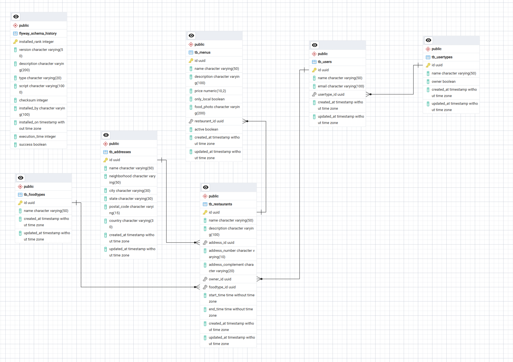

# Tech Challenge - Fase 2

## LINK DO VÍDEO:
[https://youtu.be/8_ZvFD2BmbA](https://youtu.be/8_ZvFD2BmbA)

## Sobre o projeto

API REST para gerenciamento de restaurantes, usuários, tipos de usuário, endereços, tipos de cozinha e itens de cardápio. O projeto foi estruturado em camadas inspiradas em Clean Architecture e mantém as regras de negócio independentes da camada HTTP e da persistência.

## Funcionalidades

- CRUD de tipos de usuário, incluindo a indicação de perfil proprietário;
- CRUD de usuários e associação com um tipo de usuário;
- CRUD de endereços;
- CRUD de tipos de cozinha;
- CRUD de restaurantes, associados a endereço, tipo de cozinha e usuário proprietário;
- validação do horário de funcionamento do restaurante (`startTime` deve ser anterior a `endTime`);
- CRUD de itens de cardápio, associados a um restaurante, com preço, foto, disponibilidade local e estado ativo;
- tratamento centralizado de erros de validação, negócio e recursos não encontrados;
- documentação OpenAPI/Swagger e health check com Spring Boot Actuator;
- migrations com Flyway, testes unitários e testes de integração.

## Tecnologias

- Java 21;
- Spring Boot 4.1.1;
- Spring Web MVC;
- Spring Data JPA;
- Bean Validation;
- PostgreSQL 16 (imagem Docker `postgres:16-alpine`);
- Flyway;
- springdoc-openapi 3.1.1;
- Spring Boot Actuator;
- JUnit, Mockito e Spring Test;
- H2 para testes;
- JaCoCo 0.8.13;
- Maven Wrapper 3.3.4 com Maven 3.9.16;
- Docker e Docker Compose.

As versões gerenciadas pelo Spring Boot não são fixadas individualmente no `pom.xml`.

## Arquitetura

```text
presentation ──────> application ──────> domain
                          ^                 ^
                          └── infrastructure┘
```

- `domain`: entidades e regras de negócio puras, sem dependência de Spring, web ou persistência;
- `application`: casos de uso, comandos de entrada e contratos de gateways;
- `presentation`: controllers, validações dos contratos HTTP, DTOs de request/response e presenters;
- `infrastructure`: entidades JPA, repositories, implementações dos gateways e configuração de injeção de dependências.

Os controllers convertem os DTOs HTTP em comandos da aplicação. A infraestrutura implementa as portas definidas pela camada de aplicação.

## Modelo de dados



Um tipo de usuário pode estar associado a vários usuários. Um usuário proprietário, um endereço e um tipo de cozinha podem estar associados a restaurantes. Cada restaurante pode possuir vários itens de cardápio.

## Pré-requisitos

Para execução com containers:

- Docker;
- Docker Compose.

Para execução local sem Docker:

- Java 21;
- Maven 3.9+ ou Maven Wrapper;
- PostgreSQL 16 ou compatível.

## Configuração

Crie o arquivo local de configuração a partir do exemplo:

```bash
cp .env.example .env
```

No PowerShell:

```powershell
Copy-Item .env.example .env
```

Variáveis utilizadas:

| Variável | Finalidade |
|---|---|
| `DB_HOST` | Host do PostgreSQL |
| `DB_PORT` | Porta publicada do PostgreSQL |
| `DB_NAME` | Nome do banco |
| `DB_USERNAME` | Usuário do banco |
| `DB_PASSWORD` | Senha do banco |
| `SERVER_PORT` | Porta publicada da API pelo Docker Compose |

O `.env.example` possui somente valores locais de exemplo. O arquivo `.env` é ignorado pelo Git e não deve conter credenciais destinadas ao repositório.

## Executando com Docker

```bash
docker compose up --build
```

A API fica disponível em `http://localhost:8080` com os valores do `.env.example`. Para encerrar e preservar o volume do banco:

```bash
docker compose down
```

## Executando localmente

Inicie um PostgreSQL e configure as variáveis `DB_HOST`, `DB_PORT`, `DB_NAME`, `DB_USERNAME` e `DB_PASSWORD`. Para execução fora do Compose, use `DB_HOST=localhost`.

Linux/macOS:

```bash
./mvnw spring-boot:run
```

Windows:

```powershell
.\mvnw.cmd spring-boot:run
```

Sem o wrapper, também é possível executar `mvn spring-boot:run`.

## Banco de dados e Flyway

A aplicação usa PostgreSQL e valida o schema com Hibernate. O Flyway executa automaticamente as migrations localizadas em `src/main/resources/db/migration`:

- `V1__CreateTable_UserTypes.sql`;
- `V2__CreateTable_FoodTypes.sql`;
- `V3__CreateTable_Users.sql`;
- `V4__CreateTable_Addresses.sql`;
- `V5__CreateTable_Restaurants.sql`;
- `V6__CreateTable_Menus.sql`.

## Endpoints

Todos os endpoints recebem e retornam JSON, exceto as respostas `204 No Content`.

### Tipos de usuário

| Método | Endpoint | Descrição |
|---|---|---|
| GET | `/usertypes` | Lista os tipos de usuário |
| GET | `/usertypes/{id}` | Busca um tipo de usuário |
| POST | `/usertypes` | Cria um tipo de usuário |
| PUT | `/usertypes/{id}` | Atualiza um tipo de usuário |
| DELETE | `/usertypes/{id}` | Exclui um tipo de usuário |

### Usuários

| Método | Endpoint | Descrição |
|---|---|---|
| GET | `/users` | Lista os usuários |
| GET | `/users/{id}` | Busca um usuário |
| POST | `/users` | Cria um usuário |
| PUT | `/users/{id}` | Atualiza um usuário |
| DELETE | `/users/{id}` | Exclui um usuário |

### Endereços

| Método | Endpoint | Descrição |
|---|---|---|
| GET | `/addresses` | Lista os endereços |
| GET | `/addresses/{id}` | Busca um endereço |
| POST | `/addresses` | Cria um endereço |
| PUT | `/addresses/{id}` | Atualiza um endereço |
| DELETE | `/addresses/{id}` | Exclui um endereço |

### Tipos de cozinha

| Método | Endpoint | Descrição |
|---|---|---|
| GET | `/foodtypes` | Lista os tipos de cozinha |
| GET | `/foodtypes/{id}` | Busca um tipo de cozinha |
| POST | `/foodtypes` | Cria um tipo de cozinha |
| PUT | `/foodtypes/{id}` | Atualiza um tipo de cozinha |
| DELETE | `/foodtypes/{id}` | Exclui um tipo de cozinha |

### Restaurantes

| Método | Endpoint | Descrição |
|---|---|---|
| GET | `/restaurants` | Lista os restaurantes |
| GET | `/restaurants/{id}` | Busca um restaurante |
| POST | `/restaurants` | Cria um restaurante |
| PUT | `/restaurants/{id}` | Atualiza um restaurante |
| DELETE | `/restaurants/{id}` | Exclui um restaurante |

### Cardápio

| Método | Endpoint | Descrição |
|---|---|---|
| GET | `/menus` | Lista os itens do cardápio |
| GET | `/menus/{id}` | Busca um item do cardápio |
| POST | `/menus` | Cria um item do cardápio |
| PUT | `/menus/{id}` | Atualiza um item do cardápio |
| DELETE | `/menus/{id}` | Exclui um item do cardápio |

## Swagger

Com a aplicação em execução:

- interface Swagger UI: `http://localhost:8080/swagger-ui.html`;
- especificação OpenAPI: `http://localhost:8080/v3/api-docs`.

## Actuator

O health check está disponível em `http://localhost:8080/actuator/health`.

## Testes

Executar todos os testes:

```bash
./mvnw test
```

No Windows, substitua `./mvnw` por `.\mvnw.cmd`.

Executar o ciclo completo, incluindo relatório e verificação de cobertura:

```bash
./mvnw clean verify
```

## Cobertura

O JaCoCo gera o relatório em `target/site/jacoco/index.html`. O build exige cobertura de linhas mínima de 80% no projeto e falha durante `verify` se o limite não for alcançado.

## Postman

A Collection está em [`docs/Tech-Challenge-02.postman_collection.json`](docs/Tech-Challenge-02.postman_collection.json). Importe o arquivo no Postman e execute a Collection completa na ordem apresentada.

O fluxo cria os recursos na ordem de suas dependências, captura os IDs nas variáveis da Collection, executa consultas e atualizações e, por fim, remove os registros na ordem inversa. A variável `base_url` vem configurada como `http://localhost:8080`.

## Estrutura do projeto

```text
.
├── docs/                         # Diagrama MER e Collection do Postman
├── src/
│   ├── main/
│   │   ├── java/.../
│   │   │   ├── domain/
│   │   │   ├── application/
│   │   │   ├── infrastructure/
│   │   │   └── presentation/
│   │   └── resources/
│   │       ├── db/migration/
│   │       └── application.yaml
│   └── test/                     # Testes unitários e de integração
├── .env.example
├── compose.yml
├── Dockerfile
└── pom.xml
```

## Repositório

[GitHub - fiap-tech-challenge-02](https://github.com/tadeumatos/fiap-tech-challenge-02)

## Autor

- Tadeu Matos - RM 376372
- Guilherme Felipe da Silva Souza  - RM 376359
